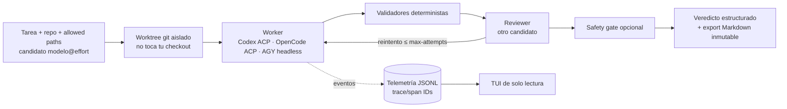

# Jho Orchestrator Lite

> A safety-first, multi-harness AI coding orchestrator (Codex, OpenCode, Google Antigravity) that runs a worker in an isolated git worktree, checks the result with deterministic validators and an independent reviewer model, records JSONL telemetry, and ends with a structured verdict — never an automatic commit, push or deploy.

**Estado:** Pausado (Operational v1.0.1, congelado a propósito para volver al producto)

## Qué problema resuelve

Trabajar con varios agentes de IA a la vez (Codex, OpenCode, Antigravity) significa lidiar con CLIs, nombres de modelo, permisos y formatos de salida distintos, y sin una forma de comparar cuál funcionó mejor. Jho pone un contrato común sobre esos harnesses. Cada ejecución queda aislada, verificada y registrada como evidencia, para decidir con datos qué modelo y flujo usar en cada tarea.

## Cómo funciona



Decisiones de diseño clave (cada una documentada como ADR en [`docs/adr/`](docs/adr/)):

- **"Modelo + effort" es la identidad del candidato** (`codex:gpt-5.6-sol@high`). Proveedor, modelo, nivel de razonamiento y rol son dimensiones separadas: sin eso las estadísticas de qué funciona mejor son engañosas.
- **Paridad entre harnesses.** Codex y OpenCode van por ACP y Antigravity por su CLI oficial headless (nunca un puente OAuth de terceros). Los tres tienen el mismo ciclo de vida, progreso y telemetría.
- **Read-only primero, edición solo en worktrees aislados.** El agente nunca edita tu checkout principal y no existe ningún camino automático a commit, push, merge o deploy.
- **Un exit code 0 no significa éxito.** Las CLIs headless pueden negar acciones en silencio, así que el veredicto sale de validadores y revisión, no del código de salida.
- **Sin chain-of-thought guardado.** La telemetría registra liveness y eventos de herramientas, no el razonamiento del modelo. Las notificaciones son best-effort y nunca cambian el veredicto.

## Qué funciona hoy

Requisitos: **WSL2/Linux**, Python 3, `git`, las CLIs de los harnesses que quieras usar (`codex`, `opencode`, `agy`) y una copia fijada de [protoAgent](https://github.com/protoLabsAI/protoAgent) v0.163.0 (ver `protoagent.lock`), sobre la que `scripts/bootstrap_local.sh` instala Jho como overlay local.

```bash
bin/jho help
bin/jho run --dry-run --task-id DEMO --repo ~/repos/project \
  --allowed-path app.py --task "Make the bounded change" \
  --candidate codex:gpt-5.6-sol@high --reviewer-candidate codex:gpt-5.6-luna@max
bin/jho tui --once            # vista de solo lectura de las corridas
bash scripts/doctor.sh        # verifica el pin de protoAgent y la instalación
python3 -m unittest discover -s tests
python3 scripts/validate_repo.py
```

- **Tests:** 187 pasan (1 omitido) en Linux/WSL. `validate_repo.py` pasa sus 3 chequeos (estructura, JSON y escaneo básico de secretos).
- Verificados: `help`, `run --dry-run` (sobre un repo de prueba), `tui --help` y `doctor`.
- Se construyó y probó (smoke read-only de los tres harnesses) para trabajar sobre un proyecto real de cliente. En este repo público su nombre se reemplazó por `client-product`.
- La documentación de diseño es amplia: arquitectura, modelo de seguridad, estrategia de routing, telemetría y visión a largo plazo. Empieza por [`docs/00_START_HERE.md`](docs/00_START_HERE.md).

## Qué no funciona / quedó pendiente

- **No es independiente:** depende de un checkout fijado de protoAgent y de un bootstrap local. En una máquina limpia hay que instalarlo primero; `run` sin `--dry-run` invoca modelos reales y consume cuota.
- **Varios documentos están desactualizados.** `docs/CURRENT_STATE.md` y `CHANGELOG.md` describen v0.2.5 y la lista de "no implementado" de ese momento. El pipeline con worktree, worker, validadores y reviewer (v1) se agregó después y no se reflejó en todos los documentos.
- No hay routing automático, scheduling según cuotas ni comparación estadística entre modelos: la visión de "optimizador adaptativo de flujos" está documentada pero no implementada.
- Las notificaciones de escritorio solo existen para Windows (desde WSL).
- Los nombres de modelos de los ejemplos reflejan mis CLIs a la fecha (sep-2026).

## Qué aprendí

- **No confiar en el exit code 0.** Una CLI headless puede "terminar bien" sin haber hecho lo pedido; hace falta verificación semántica.
- **Inicializar la observabilidad antes de separar por harness.** Un proveedor que se salta el ciclo de vida común deja puntos ciegos.
- **No arreglar fricción de permisos dando acceso a todo el home.** Hay que acotar el workspace.
- **Una capa de orquestación puede convertirse en distracción.** Congelarla a tiempo para volver al producto fue una decisión de ingeniería, no un abandono, y quedó documentada con su estrategia de salida.

## Stack

Python 3 · Bash · ACP (Agent Client Protocol) · Codex CLI · OpenCode · Google Antigravity CLI · protoAgent · JSONL telemetry · `unittest` · WSL2
